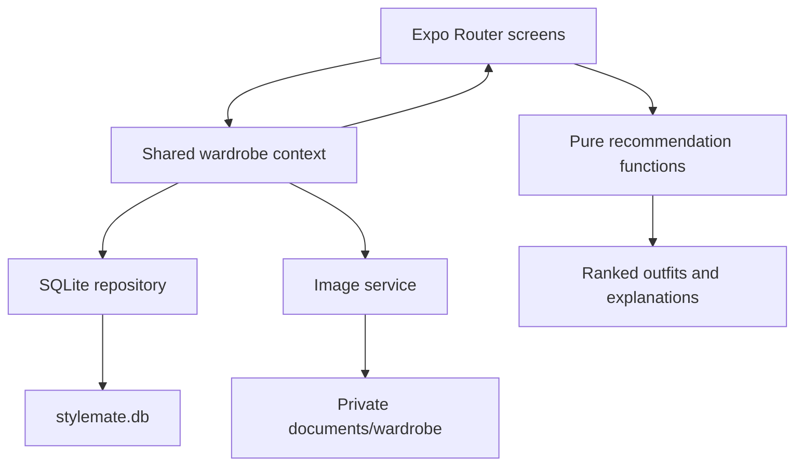

# StyleMate architecture

StyleMate is a single-user, local-first React Native application. Its implementation uses JavaScript, Expo SDK 58, Expo Router, React state/Context, SQLite and private device files. It has no backend, account, AI service or weather API.

## Data flow

`src/app/_layout.js` mounts the state provider and navigation. The four tabs are Home, Wardrobe, Discover and Profile. Clothing and outfit routes sit in the root stack. Shared controls, forms, images and outfit cards live in `src/components`.

`src/demo/DemoContext.js` retains a historical name but now owns real persisted wardrobe state. Startup opens the database, attempts pending image cleanup, then loads clothing, favorites, history and preferences. Loading/errors are visible. Retry never drops tables. Mutations run through a promise queue and refresh displayed state only after a successful write. A refresh failure after commit is explicitly reported as a reload problem, rather than claiming the write failed.

## Storage

`src/services/database.js` opens `stylemate.db` once, enables WAL and foreign keys, and initializes schema version 1 with `PRAGMA user_version`. A newer unknown schema is rejected without destructive reset. SQL values use placeholders. Multi-record writes use exclusive transactions.

| Table | Contents and purpose |
| --- | --- |
| clothing | Stable text ID, name, image URI, category/type/color/style/pattern, seasons JSON, sample illustration key, creation/update timestamps |
| outfits | Stable combination ID, generation-time JSON snapshot, favorite flag, update timestamp |
| outfit_history | Unique wear-request ID, nullable outfit reference, item snapshots JSON, worn timestamp |
| settings | Default style preference |
| image_cleanup | Managed photo URIs awaiting deletion |

IDs are text so generated and sample identities stay stable. Outfit IDs encode the sorted unique garment IDs; they do not depend on result position. `outfit_history.outfit_id` uses `ON DELETE SET NULL`. Snapshots preserve names and attributes when wardrobe items disappear. JSON is used for short arrays/display snapshots, not photo bytes.

## Photos and failures

`src/services/imageService.js` handles image-only pickers and uses Expo FileSystem `File`, `Directory` and `Paths.document`. Camera permission is requested only on action; denied access offers Settings. Gallery uses the platform selection interface. Cancellation preserves the previous choice.

A save copies a selected local URI into `documents/wardrobe` with a unique service-owned filename. Only then does SQLite store its URI. Replacement/deletion queues the old image in the same transaction as the record change. Cleanup runs after commit and retries at launch or subsequent mutations. The deletion guard accepts only direct service-named children of that managed directory. It never removes the source gallery photo.

If a database write fails, the new copy is removed where possible while the old record/photo is retained. A process crash between copying and committing, or failed rollback cleanup, can leave an orphan file. There is no broad directory sweep. A missing image produces a visible replacement hint. Original Phase 2 in-memory metadata cannot be reconstructed after it was lost.

## Recommendations

`src/utils/compatibility.js` centralizes occasion/style/weather rules and input normalization. `colorMatcher.js` scores the top/bottom palette. `recommendationEngine.js` builds, scores and ranks candidates without network or UI calls. It receives an explicit reference time, making results reproducible for the same inputs and clock. See [rules and worked example](RECOMMENDATIONS.md).

The bounded search evaluates at most 40 eligible garments per category and 1,600 core pairs. Each outfit requires one top and bottom; compatible footwear, a layer and an accessory are optional. At most three unique combinations are returned. Scores are heuristic guidance, not objective fashion judgments.

## Favorites and history

Each outfit can be saved independently. Scores/reasons remain generation-time snapshots. Missing items retain their saved names and disable wear recording; changed core categories also require regeneration. Wear writes re-read the database inside the mutation queue to avoid using an outdated card. Previously worn combinations require confirmation for another entry. An in-flight lock prevents duplicate taps; unique request IDs also make repeated database requests idempotent. The current item snapshot and timestamp are stored for each wear and used by repetition scoring.

## Privacy, testing and limits

Application data and photos are processed locally. No secrets or environment variables are required. Development Metro connectivity is separate from offline behavior of an installed build. Device uninstall removes app-owned data; there is no backup/sync feature.

Tests cover pure scoring, mocked native/UI interactions, and real SQLite close/reopen and rollback on the development host. Native permissions, rendering, keyboard behavior and installed offline operation remain unverified. See [device matrix](DEVICE_TEST_MATRIX.md). Do not describe the app as fully cross-platform tested until those entries pass.
